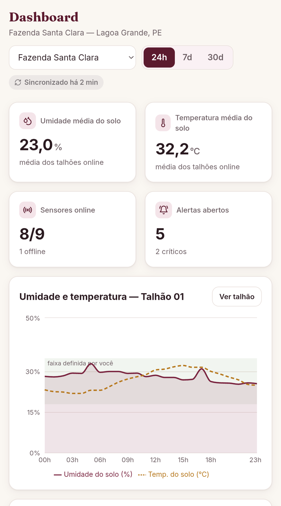
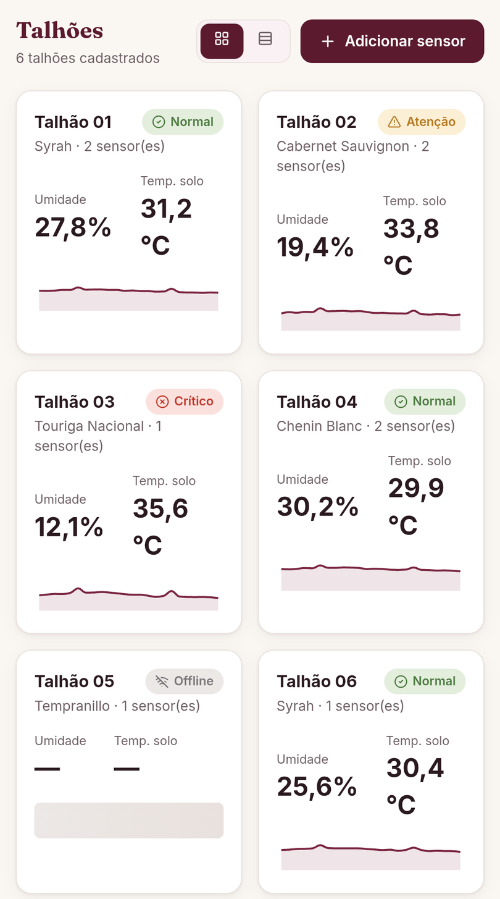
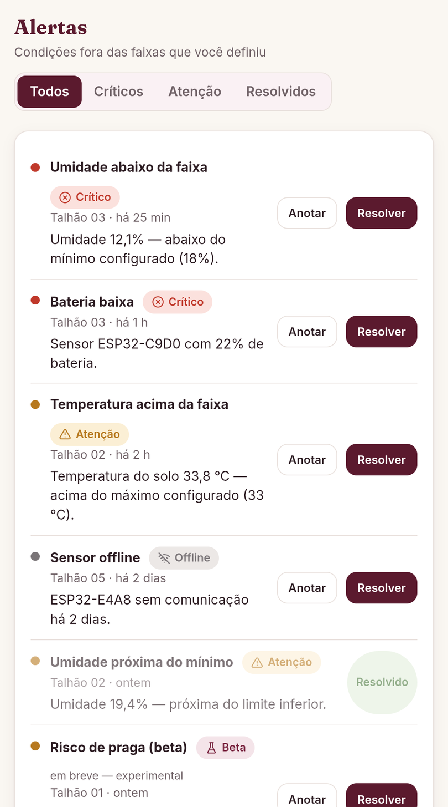
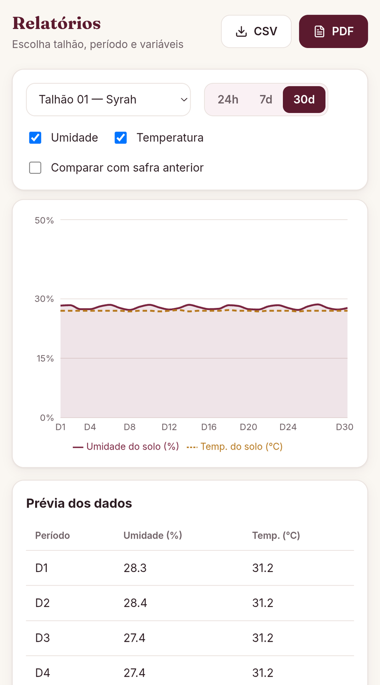
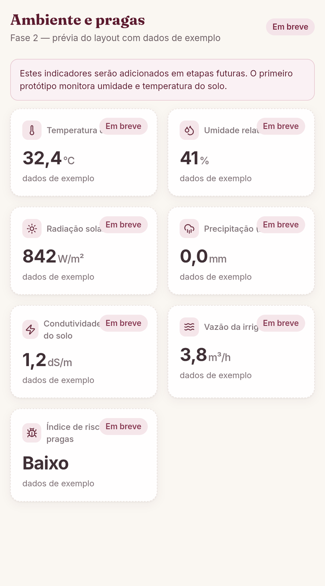

# 🍇 VinhaSense — Front-end

Interface web do **VinhaSense**, projeto de monitoramento IoT do solo para a **vitivinicultura do Vale do São Francisco**. O produtor acompanha umidade e temperatura do solo por talhão, recebe alertas quando algo sai da faixa que ele mesmo definiu e gera relatórios do histórico.

🔗 **Demo:** https://dainty-kitsune-acfb3e.netlify.app

> ⚠️ **Protótipo (v0.1):** esta versão usa **dados fictícios** (`src/data/mock.js`). A integração com o back-end e com os sensores ainda não foi feita.

---

## 📑 Sumário

- [Sobre o projeto](#-sobre-o-projeto)
- [Screenshots](#-screenshots)
- [Funcionalidades](#-funcionalidades)
- [Tecnologias](#️-tecnologias)
- [Como rodar localmente](#-como-rodar-localmente)
- [Deploy](#-deploy-netlify)
- [Estrutura](#-estrutura)
- [Próximos passos](#-próximos-passos)
- [Equipe](#-equipe)
- [Licença](#-licença)

---

## 📌 Sobre o projeto

Projeto Integrador (ADS-047) da Faculdade SENAC Recife. A solução completa tem quatro camadas; **este repositório é apenas o front-end**:

```
ESP32-C3 + DHT11  →  ThingSpeak (MQTT)  →  Back-end Node.js/Express  →  Front-end React (este repo)
```

## 📸 Screenshots

| Dashboard | Talhões | Alertas |
| --- | --- | --- |
|  |  |  |

| Relatórios | Ambiente e pragas |
| --- | --- |
|  |  |

## ✨ Funcionalidades

| Tela | O que faz |
| --- | --- |
| Login | Acesso à propriedade (simulado) |
| Dashboard | Visão geral da fazenda: umidade e temperatura médias do solo, sensores online, alertas abertos e gráfico por talhão (24h, 7d ou 30d) |
| Talhões | Lista de talhões em cards ou lista, com status (Normal, Atenção, Crítico, Offline); detalhe com variedade, porta-enxerto, histórico, sensores e anotações do produtor |
| Sensores | Detalhe do dispositivo (bateria, sinal, calibração, últimas leituras) e cadastro de sensor em 3 passos |
| Alertas | Umidade/temperatura fora da faixa, bateria baixa, sensor offline e risco de praga (beta), com filtros e ações de **Anotar** e **Resolver** |
| Relatórios | Filtros por talhão, período (24h/7d/30d) e variáveis; comparação com safra anterior; exporta **CSV** e **PDF** (impressão) |
| Ambiente e pragas | Prévia da Fase 2 (radiação solar, precipitação, condutividade, vazão da irrigação e índice de risco de pragas) — *em breve* |
| Configurações | Limites de umidade/temperatura, canais de notificação e **modo escuro** |

**Destaques:** limites definidos pelo próprio produtor (não existem valores ideais universais), layout responsivo com navegação por abas no mobile e tema claro/escuro.

## 🛠️ Tecnologias

- [React 18](https://react.dev/) + [Vite 5](https://vitejs.dev/)
- [React Router 6](https://reactrouter.com/) (`HashRouter`)
- [Recharts](https://recharts.org/) — gráficos
- [Lucide React](https://lucide.dev/) — ícones
- CSS próprio (`src/styles.css`)

## 🚀 Como rodar localmente

Pré-requisitos: [Node.js](https://nodejs.org/) 18+ e npm.

```bash
git clone https://github.com/Thauan-rgb/front-end-vinhasense.git
cd front-end-vinhasense
npm install
npm run dev
```

Abra o endereço mostrado no terminal (normalmente `http://localhost:5173`). No login, qualquer entrada funciona — os campos já vêm preenchidos.

| Script | Descrição |
| --- | --- |
| `npm run dev` | Servidor de desenvolvimento |
| `npm run build` | Build de produção em `dist/` |
| `npm run preview` | Pré-visualiza o build localmente |

## 🌐 Deploy (Netlify)

1. `npm run build`
2. Envie a pasta `dist/` no painel do Netlify, ou conecte o repositório com:
   - **Build command:** `npm run build`
   - **Publish directory:** `dist`

Como o app usa `HashRouter`, não é preciso configurar redirects para as rotas.

## 📁 Estrutura

```
front-end-vinhasense/
├── docs/              # Screenshots usados no README
├── src/
│   ├── App.jsx        # Rotas e contexto dos limites
│   ├── main.jsx
│   ├── styles.css
│   ├── components/    # Layout, Charts, ui, Logo
│   ├── pages/         # Dashboard, Talhões, Sensores, Alertas, Relatórios,
│   │                  # Ambiente, Configurações, Login
│   └── data/mock.js   # Dados fictícios (trocar por chamadas à API)
├── index.html
├── package.json
├── vite.config.js
├── LICENSE
└── README.md
```

## 🔌 Próximos passos

- Consumir a API do back-end Node.js no lugar de `mock.js`
- Autenticação real
- Fase 2: ambiente e pragas

## 👥 Equipe

Estudantes de Análise e Desenvolvimento de Sistemas — SENAC Recife:

- Arthur Vinícius 
- Marcos Vinícius
- Caio Sabino
- Thauan Bezerra
- Pedro Rodrigues

## 📄 Licença

[MIT](LICENSE) © 2026 Thauan Bezerra
